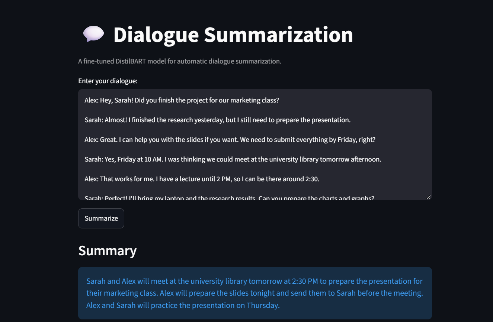

# Dialogue Summarization with Fine-Tuned DistilBART

## 📌 Project Overview

This project fine-tunes a **DistilBART** sequence-to-sequence model to summarize everyday text-message style conversations, using the **SAMSUM** dataset. The fine-tuned model is pushed to the **Hugging Face Hub** and served through an interactive **Streamlit** app, so the project covers the full path from training to a usable demo — not just a notebook.

The fine-tuned model reaches a **ROUGE-1 score of 51.20%** and a **ROUGE-L score of 42.20%** on the held-out test set.



---

## 🎯 Objective

Given a short, informal dialogue between two or more people, generate a concise, accurate summary — the kind of task useful for summarizing chat threads, meeting notes, or customer support conversations.

The project fine-tunes a pretrained summarization model on dialogue-specific data (rather than the news-style data it was originally trained on) and evaluates how much that fine-tuning improves summary quality.

---

## 📊 Dataset

The **SAMSUM** dataset (`knkarthick/samsum` on the Hugging Face Hub) contains thousands of short, multi-turn chat conversations, each paired with a human-written summary.

| Split      |  Rows | Description                          |
| ---------- | ----: | ------------------------------------- |
| Training   | 14,731 | Used to fine-tune the model           |
| Validation |    818 | Used to track performance during training |
| Test       |    819 | Held-out set, used only for final evaluation |

Each example has three fields: `id`, `dialogue` (the raw conversation), and `summary` (the human-written reference summary).

---

## ⚙️ Preprocessing

1. **Tokenization:** dialogues are tokenized as the model input (max length 1024 tokens, truncated if longer), and reference summaries are tokenized as the target labels (max length 128 tokens).
2. **Data collation:** `DataCollatorForSeq2Seq` dynamically pads each batch to the longest sequence in that batch, which is more efficient than padding every example to a fixed maximum length.
3. The original dataset columns (`id`, `dialogue`, `summary`) are dropped after tokenization, leaving only the `input_ids`, `attention_mask`, and `labels` the model needs.

---

## 🤖 Model

### Base Model

**`sshleifer/distilbart-cnn-12-6`** — a distilled version of BART, originally fine-tuned on CNN/DailyMail news articles for summarization. It's smaller and faster than full BART while retaining most of its summarization quality, which made it a practical starting point to further fine-tune on dialogue-style text.

### Fine-Tuning Setup

| Setting                | Value                          |
| ----------------------- | ------------------------------- |
| Base model               | `sshleifer/distilbart-cnn-12-6` |
| Learning rate            | 5e-5                            |
| Batch size (train / eval)| 4 / 4                           |
| Epochs                   | 1                                |
| Weight decay              | 0.01                             |
| Eval / save strategy      | Every epoch, best model restored at the end |

Training was done with Hugging Face's `Seq2SeqTrainer`, which handles the training loop, evaluation, and checkpointing.

**Final training loss: 1.654** (over 3,683 steps, ~1,722 seconds of training).

---

## 📈 Evaluation

The model was evaluated on the full **819-example test set** using **ROUGE**, the standard metric for summarization quality (it measures n-gram and longest-common-subsequence overlap between the generated summary and the human reference).

| Metric     | Score |
| ---------- | ----: |
| ROUGE-1    | 51.20% |
| ROUGE-2    | 26.60% |
| ROUGE-L    | 42.20% |
| ROUGE-Lsum | 42.23% |

### Example

**Dialogue (test set, example 1):**
> A short conversation about Hannah needing Betty's phone number and being pointed to Larry, who has it.

**Fine-tuned model summary:**
> "Amanda can't find Betty's number. Larry called her last time they were at the park together."

**Reference (human-written) summary:**
> "Hannah needs Betty's number but Amanda doesn't have it. She needs to contact Larry."

The model summary captures the core structure of the conversation (who doesn't have the number, who to contact instead) but introduces a factual detail ("Larry called her ... at the park") not present in the reference — a reminder that even a reasonable-looking summary can contain details the model generated rather than details grounded in the source text.

---

## 🔍 Analysis

- **ROUGE-1 (51.20%) is notably higher than ROUGE-2 (26.60%)**, meaning the model captures the right individual words and topics more reliably than exact two-word phrase sequences — a common pattern in abstractive summarization, where the model paraphrases rather than copies.
- **Only 1 training epoch was used**, and training loss was still fairly high (1.654) at the end of it. This suggests there's likely room for improvement with more epochs — the model may not have fully converged.
- **The model is capable of generalizing dialogue structure** (who said what, cause and effect) even from a base model that was originally trained on formal news articles, showing that the fine-tuning successfully adapted it to a very different writing style.

---

## 🚀 Deployment

The fine-tuned model is hosted on the **Hugging Face Hub**: [`Ahmed-1511/distilbart-samsum`](https://huggingface.co/Ahmed-1511/distilbart-samsum)

A **Streamlit** app (`app.py`) loads the model directly from the Hub and lets users paste in any dialogue to get an instant summary:

- The model and tokenizer are cached with `@st.cache_resource` so they're loaded only once per session, not on every click.
- Summaries are generated with beam search (`num_beams=4`) for more coherent output than greedy decoding.


---

## 🔭 Limitations & Future Improvements

- **Only 1 epoch of fine-tuning:** training for more epochs (with early stopping based on validation ROUGE) would likely improve summary quality further.
- **No hyperparameter tuning:** learning rate, batch size, and generation parameters (`num_beams`, `max_length`) were set to reasonable defaults rather than tuned.
- **Factual consistency isn't directly measured:** ROUGE measures word/phrase overlap, not whether the summary is factually faithful to the source — the example above shows the model can introduce unsupported details. A dedicated faithfulness metric or human evaluation would give a fuller picture.
- **Single dataset domain:** the model is fine-tuned only on SAMSUM-style casual chat. Performance on other dialogue types (customer support transcripts, meeting notes) is untested.
- **Larger batch size:** training used a batch size of 4 due to compute constraints; a larger effective batch size (via gradient accumulation) might stabilize training.

---

## 🧠 Key NLP / Deep Learning Concepts Demonstrated

- Sequence-to-sequence (Seq2Seq) modeling for text generation
- Transfer learning: fine-tuning a pretrained summarization model on a new domain
- Tokenization for both model inputs and generation targets
- Dynamic padding with `DataCollatorForSeq2Seq`
- Fine-tuning with Hugging Face's `Seq2SeqTrainer` and `Seq2SeqTrainingArguments`
- Beam search decoding for text generation
- ROUGE evaluation (ROUGE-1, ROUGE-2, ROUGE-L, ROUGE-Lsum)
- Publishing a model to the Hugging Face Hub
- Building and deploying an interactive demo with Streamlit
- Caching expensive resources in a Streamlit app

---

## 🛠️ Technologies

- **Python**
- **PyTorch**
- **Hugging Face Transformers**
- **Hugging Face Datasets**
- **Hugging Face Evaluate** (ROUGE)
- **Hugging Face Hub**
- **Streamlit**
- **Jupyter Notebook / Google Colab**

---

## 📁 Project Structure

```text
Summarization-Project/
│
├── Summarization_Project.ipynb
├── app.py
├── streamlit_app.png
├── README.md
├── requirements.txt
└── .gitignore
```

The fine-tuned model weights are **not** stored in this repository — they're hosted on the Hugging Face Hub and loaded automatically by `app.py`.

---

## 🚀 How to Run

### 1. Clone the repository

```bash
git clone https://github.com/Ahmed-Abdelfattah-tech/Summarization-Project.git
cd Summarization-Project
```

### 2. Install dependencies

```bash
pip install -r requirements.txt
```

### 3. Run the Streamlit app

```bash
streamlit run app.py
```

This downloads the fine-tuned model from the Hugging Face Hub (`Ahmed-1511/distilbart-samsum`) automatically on first run, then opens the app in your browser.

### 4. (Optional) Reproduce the training notebook

Open `Summarization_Project.ipynb` and run the cells sequentially. The SAMSUM dataset is downloaded automatically from the Hugging Face Hub — no manual download needed. A GPU runtime is recommended for training.

---

## 📌 Key Takeaways

This project fine-tunes DistilBART on dialogue summarization and takes it all the way to a deployed, usable app:

> **Base model fine-tuned on SAMSUM → 51.20% ROUGE-1 / 42.20% ROUGE-L on the test set → deployed on Hugging Face Hub + Streamlit**

Beyond the metric, the project highlights an important lesson in generative NLP: a fluent, well-structured summary isn't automatically a faithful one — evaluating generated text means looking past surface-level scores at what the model actually produces.

---

## 👤 Author

**Ahmed Abdelfattah**
